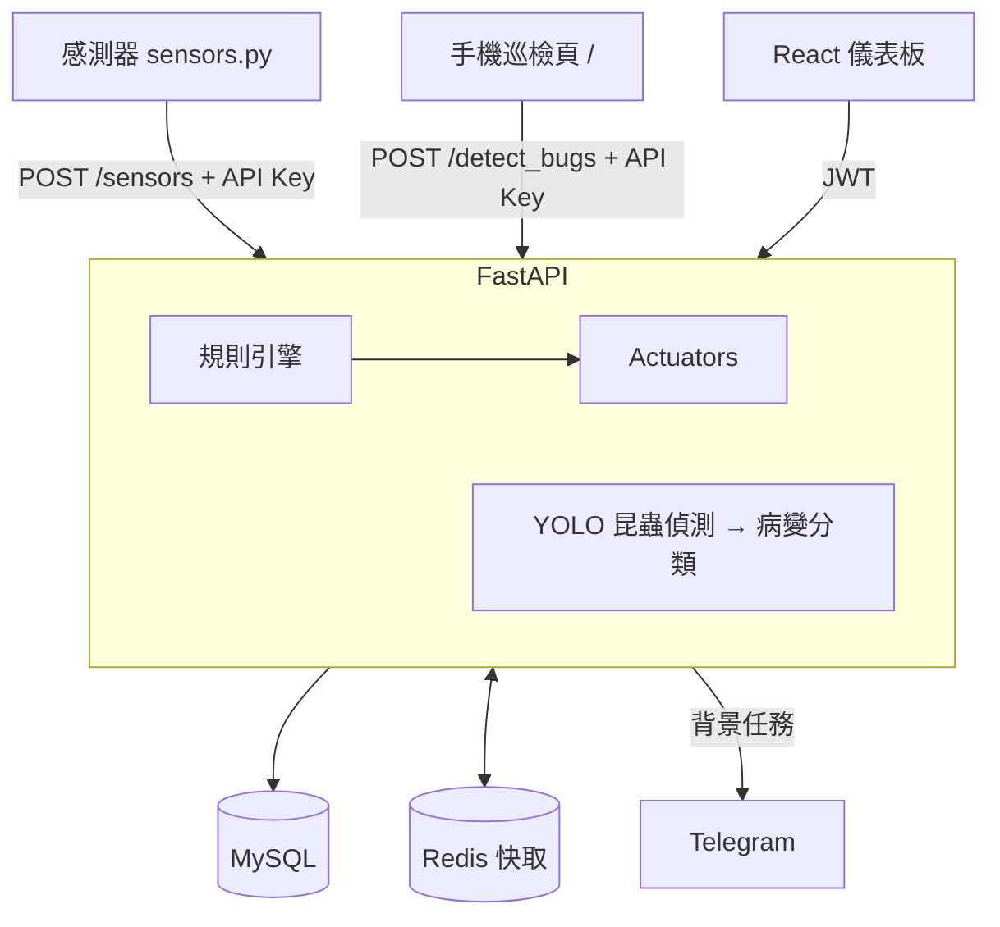
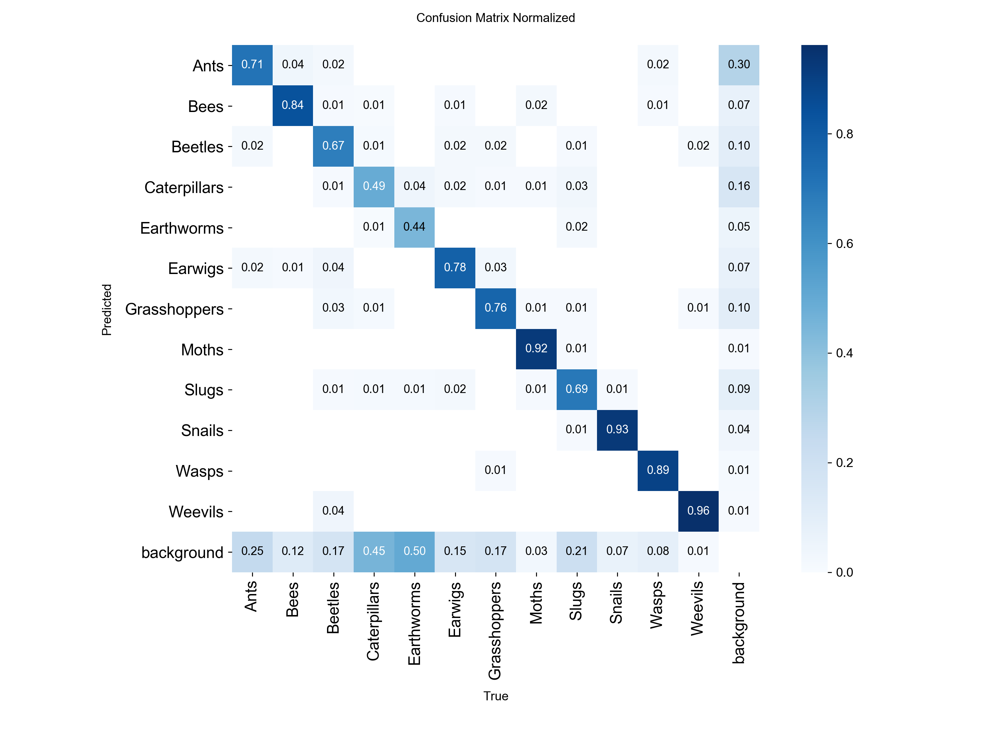
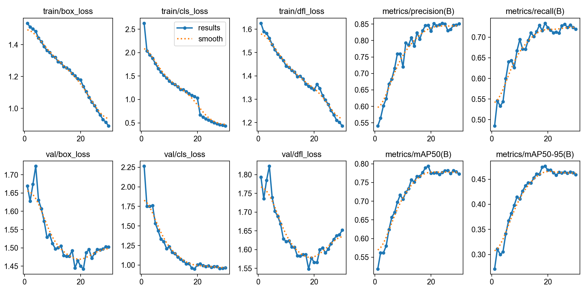

# 🌾 Smart Eco-Farm — 智慧溫室監控與病蟲害偵測系統

[](https://github.com/Albertchiang40210/smart_eco_farm/actions)


一個端到端的 IoT + 電腦視覺專案：感測器上報溫濕度 → 後端依資料庫規則自動控制風扇／水泵；現場以手機拍照 → 雙模型（昆蟲偵測 + 葉片病變分類）診斷 → Telegram 警報；React 儀表板即時檢視。

> 這是個人作品集專案。硬體（風扇、水泵、感測器）以軟體模擬，其餘軟體鏈路皆可實際運行。

<!-- TODO: 在此放儀表板與手機巡檢端截圖，例如 docs/dashboard.png -->

## 功能

| 模組 | 說明 |
|---|---|
| **雙模型影像診斷** | YOLOv8s 偵測 12 類昆蟲；偵測不到時改交 YOLOv8 分類模型判斷葉片病變。支援載入 ONNX 權重（`export_onnx.py` 匯出）。推論在 thread pool 執行，不阻塞事件迴圈。 |
| **規則引擎** | 規則存在 MySQL `environment_rules`（感測類型、運算子 `> < >= <=`、閾值、目標設備），感測資料進來時逐條評估。改規則不需重啟或改程式。 |
| **執行器抽象層** | `actuators.py` 模擬 PLC：狀態去重與 5 秒冷卻，避免臨界值附近設備頻繁開關。 |
| **認證** | 使用者端 JWT（HS256，bcrypt 雜湊管理員密碼）；IoT 裝置與手機端使用 `X-API-Key`（常數時間比對）。所有金鑰由環境變數提供，未設定即停用登入。 |
| **快取** | 歷史數據查詢以 Redis 快取 10 秒；Redis 不可用時自動退回直查 MySQL。 |
| **警報** | Telegram Bot 推播（含標註圖片），於背景任務送出，不拖慢 API 回應。 |
| **儀表板** | React + TypeScript，登入、10 秒自動更新、錯誤提示。 |
| **維運** | Loguru 日誌輪替、`cleanup.py` 清理舊資料、Docker healthcheck、GitHub Actions（pytest + 前端 lint/build）。 |

## 架構



## 模型成效

昆蟲偵測（YOLOv8s，12 類，416×416，30 epochs，Apple M-series MPS 訓練約 2 小時），驗證集：

| Precision | Recall | mAP@50 | mAP@50-95 |
|---|---|---|---|
| 0.85 | 0.72 | 0.77 | 0.46 |




類別：Ants, Bees, Beetles, Caterpillars, Earthworms, Earwigs, Grasshoppers, Moths, Slugs, Snails, Wasps, Weevils。葉片病變分類模型由 `train.py` 訓練，尚未附上量化指標。

## 快速開始

### Docker（建議）

```bash
cp .env.example .env     # 填入所有 change_me；缺少必要值時 compose 會直接報錯
docker compose up --build -d
```

| 服務 | 位址 |
|---|---|
| 儀表板 | http://localhost:3000 |
| API 文件（Swagger） | http://localhost:8001/docs |
| 手機巡檢頁 | http://localhost:8001/ |

模型權重不在 repo 內：訓練後放到 `result/train/weights/best.pt`（昆蟲）與 `result/runs/classify/train/weights/best.pt`（病變），或以 `python export_onnx.py` 轉成 `.onnx`。找不到時退回通用 `yolov8s.pt`，僅供展示。

模擬感測器上報：

```bash
pip install -r requirements.txt
SENSOR_API_URL=http://localhost:8001/api/v1/sensors python sensors.py
```

### 本機開發與測試

```bash
pip install -r requirements-dev.txt
pytest -q                        # 使用 SQLite、不載入模型，不需 MySQL / Redis

cd frontend && cp .env.example .env && npm ci && npm run dev
```

## API

| Method | Path | 驗證 | 說明 |
|---|---|---|---|
| POST | `/api/v1/login` | — | 取得 JWT |
| POST | `/api/v1/sensors` | API Key | 上報感測值，回傳觸發的自動控制 |
| POST | `/api/v1/detect_bugs` | JWT 或 API Key | 上傳圖片（≤ 8 MB，僅限 image/*）進行診斷 |
| GET | `/api/v1/sensors/history` | JWT | 最近 24 筆感測紀錄 |
| GET | `/api/v1/tasks/history` | JWT | 最近 20 筆偵測紀錄 |
| GET | `/api/v1/health` | — | 健康檢查 |

## 專案結構

```text
main.py            FastAPI 應用：路由、規則引擎、推論流程
auth.py            JWT 與 API Key 驗證
settings.py        環境變數集中管理
database.py        SQLAlchemy 模型與預設規則
actuators.py       風扇／水泵控制抽象層（模擬）
notifier.py        Telegram 推播
sensors.py         模擬 IoT 感測器
cleanup.py         過期資料與影像清理
train.py / train_insect.py / export_onnx.py   訓練與 ONNX 匯出
farm_app.py        早期 Streamlit 版儀表板（選用，見 requirements-extras.txt）
frontend/          React 儀表板
test_main.py       pytest 測試
```

## 已知限制與未來規劃

- 單一管理員帳號（來自環境變數），尚無多使用者與角色權限。
- 執行器為軟體模擬；真實部署需接 MQTT／GPIO。規則以「任一條成立即 ON」評估，尚無遲滯（hysteresis）。
- 設備狀態存在 API 程序記憶體內，多 worker 部署需改存 Redis。
- 尚未做壓力測試，不宣稱吞吐量；若要擴充可考慮批次寫入或訊息佇列。
- 資料表以 `create_all` 建立，尚未導入 Alembic migration。
- 病變分類模型尚缺評估指標與資料集來源說明。

## License

MIT
