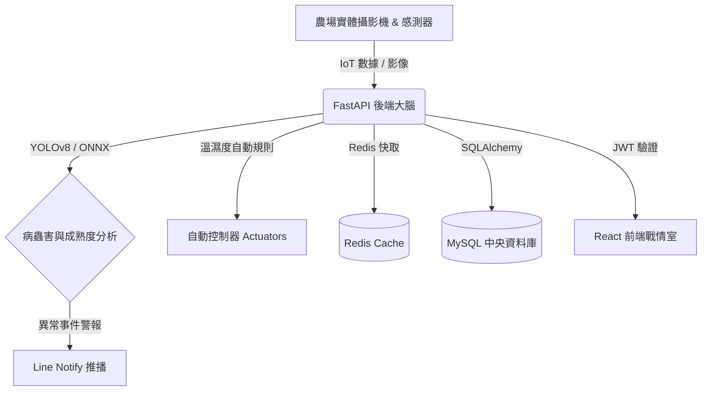

# 🌾 AI-Powered Smart Eco-Farm & Environmental Monitoring System

[](https://www.python.org/)
[](https://github.com/ultralytics/ultralytics)
[](https://www.mysql.com/)
[](https://react.dev/)
[](https://www.docker.com/)

這是一個結合了 **電腦視覺（Computer Vision）、關聯式資料庫（MySQL）、現代化前端 (React) 與微服務容器 (Docker)** 的 **企業級智慧農業自動化管理系統**。系統旨在解決傳統農業高度依賴人工巡檢的痛點，透過 Edge AI 進行作物病蟲害追蹤，並將即時環境數據寫入資料庫，打造數據驅動的現代化新農業解決方案。

---

## 🚀 核心技術亮點 (Enterprise Features)

本系統經歷了深度架構升級，具備商業級的穩定度與效能：

- **Edge AI 推論加速 (ONNX):** 利用 YOLOv8 偵測病蟲害，並提供轉檔腳本 (`export_onnx.py`) 匯出為 ONNX 格式，使用 ONNXRuntime 大幅加速推論效率，完美支援邊緣裝置部署。
- **動態智慧規則引擎 (Dynamic Rules):** 捨棄寫死的環境門檻，支援動態讀取資料庫的感測器閥值 (如：溫度、濕度)，自動觸發排風扇、灌溉水泵等硬體設備，極具彈性。
- **高併發與資料庫工程 (Redis + SQLAlchemy):** 使用 SQLAlchemy ORM 管理資料表，並導入 **Redis** 記憶體資料庫作為歷史數據快取，有效減輕 MySQL 壓力，足以應付萬級 IoT 感測器寫入。
- **企業級資安防護 (JWT + Bcrypt):** 導入 OAuth2 JWT 憑證授權機制，鎖死 API，防禦未授權存取。
- **現代化戰情室 (React PWA):** 徹底前後端分離，透過 Vite + React + Tailwind CSS 打造了全新的現代化環境監控儀表板。
- **全自動維運 (DevOps & Logging):** 導入 `Loguru` 結構化日誌記錄，內建 `Pytest` 單元測試，並配置 GitHub Actions 進行 CI/CD 流水線檢查。提供每日自動清理腳本 (`cleanup.py`) 防止硬碟爆滿。

---

## 📐 系統架構圖 (System Architecture)


---

## 📂 專案目錄結構 (Project Structure)

```text
SMART_ECO_FARM/
├── .github/workflows/    # CI/CD 自動化測試腳本
├── frontend/             # React + Vite 現代化前端戰情室
├── logs/                 # Loguru 結構化日誌存放區
├── database.py           # SQLAlchemy ORM 結構與資料庫連線
├── main.py               # FastAPI 核心大腦路由與推論邏輯
├── auth.py               # JWT 驗證與加密核心
├── notifier.py           # Line Notify 自動推播模組
├── cleanup.py            # 過期影像與資料庫紀錄清理排程
├── export_onnx.py        # YOLO 模型轉 ONNX 腳本
├── test_main.py          # PyTest 測試腳本
├── docker-compose.yml    # 微服務環境一鍵啟動配置
└── .env                  # 資料庫連線、金鑰與 LINE Token 管理
```

---

## 🛠️ 快速開始 (Getting Started)

本系統支援 **Docker 一鍵部署**，強烈建議使用 Docker 啟動，避免環境衝突。

1. **環境配置:**
   請在根目錄修改 `.env` 檔案（填寫 `LINE_NOTIFY_TOKEN` 以啟用警報）。

2. **一鍵啟動所有微服務:**
   ```bash
   docker-compose up --build -d
   ```
   系統將同時啟動：
   * `farm_mysql`: MySQL 資料庫 (Port: 3308)
   * `farm_redis`: Redis 快取 (Port: 6379)
   * `farm_backend`: FastAPI 後端大腦 (Port: 8001)
   * `react_web_service`: React 前端戰情室 (Port: 3000)

3. **瀏覽戰情室:**
   打開瀏覽器訪問 `http://localhost:3000`

---

## 📈 DevOps 與自動化測試
若您希望在本地開發並測試：
```bash
# 安裝依賴
pip install -r requirements.txt

# 執行自動化測試
pytest test_main.py
```
本專案已整合 GitHub Actions，推送程式碼將自動觸發 `main.yml` 檢查。
